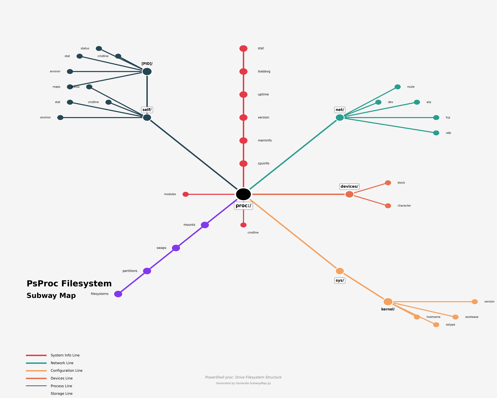

# PowerShell proc: Drive

A PowerShell 7 module for Windows that exposes system information as a Linux-style
`/proc` pseudo-filesystem, built on [SHiPS](https://github.com/PowerShell/SHiPS).
Files follow the Linux layouts in [proc(5)](https://man7.org/linux/man-pages/man5/proc.5.html)
wherever Windows has an equivalent, so habits and parsers carry over.

```powershell
cd proc:
cat meminfo
cat net\tcp
cat $PID\stat
```

## Requirements

- Windows 10/11 or Windows Server 2016+
- PowerShell 7.0+
- The SHiPS module (the installer fetches it). Note that SHiPS itself has not had a
  release since 0.8.1 in 2019; it works on PowerShell 7.6, but upstream fixes are unlikely.

## Installation

```powershell
.\Install-ProcDrive.ps1 -Install                 # this session only
.\Install-ProcDrive.ps1 -Install -AddToProfile   # mount proc: in every new session
```

`-Install` copies the module to your CurrentUser module path
(`Documents\PowerShell\Modules\ProcFileSystem\<version>`), imports it, and mounts `proc:`
globally. It is safe to re-run.

To remove it:

```powershell
.\Install-ProcDrive.ps1 -Uninstall               # unmount and unload
.\Install-ProcDrive.ps1 -Uninstall -RemoveFiles  # also delete the module and the profile entry
```

Manual setup, if you prefer:

```powershell
Install-Module SHiPS -Scope CurrentUser
Import-Module .\ProcFileSystem.psd1
Mount-ProcDrive                         # global and idempotent; Dismount-ProcDrive removes it
```

Use `Mount-ProcDrive` rather than `New-PSDrive` from scripts and functions:
`New-PSDrive` defaults to the caller's local scope, so a drive created inside a script
disappears when the script returns.

## On Linux

An Easter egg, since Linux already has the real thing: the same install works under
PowerShell 7 on Linux, where `proc:` maps straight onto `/proc`.

```powershell
./Install-ProcDrive.ps1 -Install       # installs to ~/.local/share/powershell/Modules
cat proc:\4\stat                        # reads /proc/4/stat; \ and / both work
```

SHiPS is still required (the Windows provider's classes have to load), but it isn't
used. Two differences from Windows: you get every file Linux has, and `Get-Content`
returns an array of lines rather than one string (`-Raw` works too). The idioms below,
such as `-split "`r?`n"`, splitting `stat` after the last `)`, and `TrimEnd("`0")`,
behave the same on both.

## Reading files

**Each file is returned as one string.** `Get-Content -Raw` is not supported by the
SHiPS provider (and isn't needed). To work line by line, split it:

```powershell
$lines = (Get-Content proc:\meminfo) -split "`r?`n"
$lines | Select-String MemAvailable
```

Files that Linux NUL-separates (`cmdline`, `environ`) are NUL-separated here too:

```powershell
(Get-Content proc:\self\cmdline).TrimEnd("`0") -split "`0"
```

## Layout

| Path | Contents | Windows source |
|---|---|---|
| `cpuinfo` | One block per logical CPU: family/model/stepping, MHz, cache, real feature flags | `Win32_Processor`, `IsProcessorFeaturePresent` |
| `meminfo` | Memory and swap in kB (mapping below) | Memory performance counters, page files |
| `stat` | Cumulative per-CPU ticks since boot, `intr`, `ctxt`, `btime` | Raw processor and system counters |
| `loadavg` | 1/5/15-minute load, runnable/total threads, newest PID | Built-in sampler (below) |
| `uptime` | Seconds since boot, idle seconds summed over CPUs | `GetTickCount64`, `GetSystemTimes` |
| `version` | OS caption, build, architecture | `Win32_OperatingSystem` |
| `cmdline` | Boot loader options (the kernel command line) | `SystemStartOptions` |
| `mounts` | Volume GUID path or UNC share, mount point, fs type, ro/rw | `Win32_Volume`, `Win32_LogicalDisk` |
| `filesystems` | Filesystem drivers currently loaded, Linux names | `Win32_SystemDriver` |
| `swaps` | Page files, sizes in kB | `Win32_PageFileUsage` |
| `partitions` | Disks and partitions in 1 KiB blocks, named `disk0`, `disk0p1`, ... | `Win32_DiskDrive`, `Win32_DiskPartition` |
| `modules` | Running kernel drivers | `Win32_SystemDriver` |
| `net\dev` | Per-interface rx/tx bytes, packets, errors, drops | `Get-NetAdapterStatistics` |
| `net\tcp`, `net\tcp6` | Sockets in Linux hex format with Linux state codes | `Get-NetTCPConnection` |
| `net\udp`, `net\udp6` | UDP endpoints in Linux hex format | `Get-NetUDPEndpoint` |
| `net\route` | IPv4 routes: hex dest/gateway/mask, RTF flags, effective metric | `Get-NetRoute` (active store) |
| `net\arp` | Neighbor cache with ATF flags | `Get-NetNeighbor` |
| `sys\kernel\{hostname,ostype,osrelease,version}` | Host and OS identity | environment, `Win32_OperatingSystem` |
| `devices\{block,character}` | Static Linux-style major number tables | none (illustrative) |
| `<PID>\`, `self\` | `cmdline`, `status`, `stat`, `environ`, `maps` | `Get-Process`, `NtQueryInformationProcess` |

### Process files

- **`stat`** has all 52 proc(5) fields in order. As on Linux, comm (field 2) can contain
  spaces, so parse by splitting after the last `)` rather than on every space. Real values: pid, comm (15 chars, like
  Linux), state, ppid, session (the Windows session id), utime/stime in ticks, priority
  and nice (mapped from the priority class), num_threads, starttime in ticks since boot,
  vsize, rss in 4 KiB pages. Fields with no Windows equivalent are 0.
- **`status`** gives Name, State, Tgid, Pid, PPid, VmPeak, VmSize, VmHWM, VmRSS, VmData
  and Threads.
- **State** is derived from thread states: `R` if any thread is running or ready, `T` if
  every thread is suspended, otherwise `S`.
- **`cmdline`** is split with `CommandLineToArgvW`, so a quoted argument containing
  spaces stays one argument. It is empty for processes whose command line can't be read
  (Idle, System, protected processes), as for Linux kernel threads.
- **`environ`** is only readable for `self`; other processes raise an access error.
- **`maps`** lists loaded module images only. Windows doesn't expose heaps and stacks
  the same way.

### Memory mapping

| Linux field | Windows value |
|---|---|
| `MemFree` | Free and zeroed page lists |
| `MemAvailable` | Available Bytes (free + standby) |
| `Cached` | Standby lists (Windows' page cache) |
| `Dirty` | Modified page list |
| `Slab` / `SReclaimable` / `SUnreclaim` | Paged + non-paged pool / paged pool / non-paged pool |
| `SwapTotal` / `SwapFree` | Page files only |
| `CommitLimit` / `Committed_AS` | Commit limit / committed bytes |
| `Buffers`, `Shmem`, `SwapCached` | 0 (no equivalent) |

### Load average

Windows keeps no run-queue average. From the moment the module loads, a background timer
samples CPU demand (busy fraction × CPU count) every 5 seconds and applies Linux's
exponential decay for the 1-, 5- and 15-minute averages, seeded with the average since
boot. It measures CPU demand only; threads waiting on disk, which Linux would count,
are not included.

### Differences from Linux worth knowing

- `stat`'s `processes` line is the current process count; Windows has no forks-since-boot counter.
- `loadavg`'s last field is the most recently started PID. Windows PIDs aren't sequential.
- In `net\tcp*` and `net\udp*`, `uid` and `inode` are 0. To map a socket to a process,
  use `Get-NetTCPConnection`, which has `OwningProcess`.
- `mounts` escapes whitespace but leaves backslashes as they are, so Windows paths stay readable.
- Interface names in `net\*` are the Windows aliases and can contain spaces
  (`Wi-Fi`, `Ethernet 2`). `net\route` is tab-separated, so split on tabs.

## Caching

Process directories and the root listing are live: new processes appear and exited ones
disappear without refreshing. Other directory listings (`net`, `sys`, `devices`) are
cached by SHiPS; `ls -Force` refreshes them. File contents are generated fresh on every read.

## Examples

```powershell
# Memory as an object (values in kB)
$mem = @{}
foreach ($l in (Get-Content proc:\meminfo) -split "`r?`n") {
    if ($l -match '^(\w+):\s+(\d+) kB') { $mem[$Matches[1]] = [long]$Matches[2] }
}
'{0:N1} GB available of {1:N1} GB' -f ($mem.MemAvailable / 1MB), ($mem.MemTotal / 1MB)

# CPU usage over one second from /proc/stat, the way top computes it
$read = { ((Get-Content proc:\stat) -split "`r?`n")[0] -split '\s+' | Select-Object -Skip 1 | ForEach-Object { [long]$_ } }
$a = & $read; Start-Sleep 1; $b = & $read
$total = ($b | Measure-Object -Sum).Sum - ($a | Measure-Object -Sum).Sum
'{0:P0} busy' -f (1 - ($b[3] - $a[3]) / $total)

# Boot time
$btime = ((Get-Content proc:\stat) -split "`r?`n" | Where-Object { $_ -like 'btime *' }).Split(' ')[1]
[DateTimeOffset]::FromUnixTimeSeconds($btime).LocalDateTime

# Listening TCP ports (state 0A), decoded from hex
(Get-Content proc:\net\tcp) -split "`r?`n" | Select-Object -Skip 1 | Where-Object { $_ } |
    ForEach-Object { $f = $_.Trim() -split '\s+'; if ($f[3] -eq '0A') { [Convert]::ToInt32($f[1].Split(':')[1], 16) } } |
    Sort-Object -Unique

# Top five processes by resident memory. comm (field 2) can contain spaces, e.g.
# "(Creative Cloud)", so split after the last ')' as Linux tools do: field N is $rest[N-3].
Get-ChildItem proc:\ | Where-Object Name -match '^\d+$' | ForEach-Object {
    $s = Get-Content "proc:\$($_.Name)\stat" -ErrorAction SilentlyContinue   # processes can exit mid-loop
    if ($s) {
        $close = $s.LastIndexOf(')')
        $rest = $s.Substring($close + 2) -split ' '
        [pscustomobject]@{ Pid = $_.Name; Name = $s.Substring($s.IndexOf('(') + 1, $close - $s.IndexOf('(') - 1); RssMB = [long]$rest[21] * 4KB / 1MB }
    }
} | Sort-Object RssMB -Descending | Select-Object -First 5

# A process's argv
$p = Get-Process -Id $PID
(Get-Content "proc:\$($p.Id)\cmdline").TrimEnd("`0") -split "`0"
```

## Testing

```powershell
Install-Module Pester -MinimumVersion 5.0 -Scope CurrentUser
.\Test-ProcDrive.ps1 -RunTests                    # exit code = number of failed tests
.\Test-ProcDrive.ps1 -RunTests -IncludeInstaller  # also round-trips the installer
.\Test-ProcDrive.ps1 -Demo                        # one-screen system summary
.\Test-ProcDrive.ps1 -Benchmark                   # read timings
```

The tests check values against Windows' own APIs, not just that files are non-empty: for
example that every `net\tcp` row decodes to a live connection and that `stat` counters
grow between reads. The installer tests write to your real module path and profile, so
they are opt-in. They restore both afterwards and skip themselves if the module is already
installed.

## Performance

Most files take 50–400 ms because they query WMI or performance counters. `cpuinfo` takes
about a second, almost all of it in `Win32_Processor` itself. Listing the root directory,
PIDs included, takes about 25 ms.

## Visualization



*The proc: layout drawn as a subway map: each colored line is one category of files,
with `proc:\` as the central hub.*

```powershell
.\New-SubwayMap.ps1                                # regenerate codebase-subway-map.png
.\New-SubwayMap.ps1 -Open                          # and open it
.\New-SubwayMap.ps1 -OutputPath my-map.png
```

Or with Python directly:

```bash
python3 Generate-SubwayMap.py --output my-map.png --dpi 150
```

Lines: **System Info** (red) for cpuinfo, meminfo, version, uptime, loadavg and stat;
**Network** (teal) for `net\`; **Configuration** (orange) for `sys\kernel\`; **Devices**
(coral) for `devices\`; **Process** (dark blue) for `self\` and `<PID>\`; **Storage**
(purple) for mounts, swaps, partitions and filesystems.

Requires Python 3 with matplotlib and numpy (`pip install matplotlib numpy`);
`New-SubwayMap.ps1` installs missing packages itself.

## Status and remaining work

Tested on Windows 11 Pro (build 26300), PowerShell 7.6.10, SHiPS 0.8.1 and Pester 6.2.0:
66 tests pass, elevated and under a restricted (Basic User) token. The Linux mapping is
tested in the `mcr.microsoft.com/powershell` container (PowerShell 7.4.2, Ubuntu 22.04):
7 tests pass. Still to do:

**Testing gaps**
- Not yet run as an ordinary standard (non-admin, UAC-filtered) user. The test machine's
  admin account isn't UAC-filtered, so non-elevated runs used the stricter Basic User
  token, under which WMI is denied entirely and the WMI-backed system files fail.
- Not tested on Windows 10, Windows Server, ARM64, or machines with more than 64 logical
  CPUs (processor groups). The `/proc/stat` code handles `group,N` counter instances, but
  that path hasn't run on real hardware.
- No CI. The suite needs a Windows runner; a GitHub Actions `windows-latest` job running
  `.\Test-ProcDrive.ps1 -RunTests` would cover it.

**Known limitations**
- `cpuinfo` takes about a second because `Win32_Processor` does. The static fields (model,
  family, flags, cache) could be cached at import, leaving only MHz to query live.
- Importing the module by file path (`Import-Module .\ProcFileSystem.psd1`) prints a
  harmless "module not loaded" error: SHiPS re-imports the module by name in its own
  runspace and then falls back to the path. Installing with `-Install` avoids it.
- `modules` reports every driver's size as 0, since `Win32_SystemDriver` has no size.
  `EnumDeviceDrivers` plus the image headers could provide real sizes.
- `devices\block` and `devices\character` are static illustrative tables, not real data.
- `net\tcp*` and `net\udp*` report `uid` and `inode` as 0, so a socket can't be mapped to
  a process through `proc:`. A non-Linux extra column (or file) exposing `OwningProcess`
  would help.
- `loadavg` measures CPU demand only. Linux also counts threads blocked on I/O; an
  equivalent would need run-queue sampling through PDH.
- `maps` lists module images only, not heaps, stacks or other mappings
  (`VirtualQueryEx` could fill this in for processes the caller can open).
- `environ` only works for `self`. Reading another process's environment would mean
  reading its PEB with `ReadProcessMemory`.
- `stat` fields 10–13 (page faults) and per-process I/O are 0. Win32_Process `PageFaults`
  and `GetProcessIoCounters` could supply real values, and an `io` file could be added.
- The subway map predates `net\tcp6`, `net\udp6` and `self\maps`. The station lists in
  `Generate-SubwayMap.py` need those added and the PNG regenerating.
- SHiPS is unmaintained upstream. If a future PowerShell release breaks it, the provider
  would need porting to a compiled `NavigationCmdletProvider`.

## License

MIT. See [LICENSE](LICENSE).
